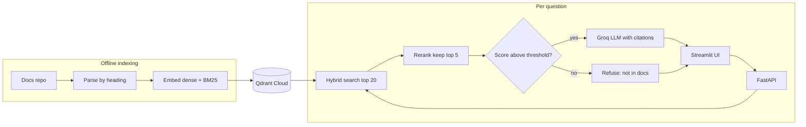

# 🧭 LangNavigator

> **A retrieval-augmented Q&A assistant for LangGraph documentation.**
> Answers developer questions with citations to exact doc sections, refuses when the docs don't contain the answer, and includes an evaluation suite that measures every design choice.

[](https://langnavigator-hhbqht7bfedr2tk4cant6t.streamlit.app/)

🔗 **Live Demo:** [LangNavigator — LangGraph Assistant on Streamlit](https://langnavigator-hhbqht7bfedr2tk4cant6t.streamlit.app/)

---

## ✨ Features

- **Hybrid retrieval** — Dense embeddings (BGE) + BM25 keyword search fused with Reciprocal Rank Fusion
- **Cross-encoder reranking** — Top 20 candidates rescored by a cross-encoder, best 5 sent to the LLM
- **Grounded citations** — Every answer cites numbered sources `[1]`, `[2]` linking to exact doc sections
- **Honest refusal** — If evidence is weak, refuses *before* calling the LLM (saves quota, prevents hallucination)
- **Ablation evaluation** — Measures Recall@5, MRR, faithfulness, and refusal accuracy across configurations
- **Free-tier deployment** — Qdrant Cloud + Render + Streamlit Community Cloud, no credit card required

## 🏗️ Architecture



## 🛠️ Tech Stack

| Layer | Choice | Why |
|-------|--------|-----|
| Embeddings | `fastembed` (BAAI/bge-small-en-v1.5) | Free, ONNX/CPU, no PyTorch |
| BM25 | `fastembed` (Qdrant/bm25) | Local, catches exact function names |
| Vector DB | Qdrant Cloud | Free 1GB cluster, native hybrid search |
| Reranker | `fastembed` cross-encoder | Local, ~80MB, accurate on 20 candidates |
| LLM | Groq free tier | Fast, OpenAI-compatible |
| Backend | FastAPI on Render | Free tier, Docker support |
| Frontend | Streamlit Community Cloud | Free hosting |
| CI | GitHub Actions | Free for public repos |

## 📁 Project Structure

```
docs-rag-assistant/
├── configs/                    # YAML configs for base + ablations
│   ├── base.yaml
│   └── ablations/
├── src/docs_rag/
│   ├── config.py               # Env vars + YAML config loading
│   ├── models.py               # Pydantic data models
│   ├── pipeline.py             # Main: search → rerank → generate
│   ├── ingest/                 # Fetch, parse, chunk, embed, upsert
│   ├── retrieval/              # Encoders, hybrid search, reranker
│   ├── generation/             # Prompts, Groq LLM client
│   └── api/                    # FastAPI app + schemas
├── ui/streamlit_app.py         # Chat frontend
├── eval/                       # Evaluation suite
│   ├── dataset/questions.jsonl
│   ├── metrics.py, judge.py, run.py
├── tests/                      # Unit + API tests
├── Dockerfile
└── .github/workflows/ci.yml
```

## 🚀 Quick Start

### Prerequisites

- Python 3.11+, [uv](https://docs.astral.sh/uv/), Docker, Git

### Setup

```bash
git clone https://github.com/shivanshu1512/docs-rag-assistant.git
cd docs-rag-assistant
uv sync
cp .env.example .env            # Fill in your API keys
```

### Run Qdrant locally

```bash
docker run -d -p 6333:6333 -v "$(pwd)/qdrant_data:/qdrant/storage" qdrant/qdrant
```

### Index the docs

```bash
# Dry run first (inspect chunks without embedding)
uv run python -m docs_rag.ingest --config configs/base.yaml --dry-run

# Full index
uv run python -m docs_rag.ingest --config configs/base.yaml --full
```

### Run the API

```bash
uv run uvicorn docs_rag.api.main:app --reload
# Interactive docs at http://localhost:8000/docs
```

### Run the UI

```bash
# Create .streamlit/secrets.toml with: API_URL = "http://localhost:8000"
uv run streamlit run ui/streamlit_app.py
```

### Tests

```bash
uv run ruff check .
uv run pytest -v
```

## 📊 Evaluation

### Ablation Results (test split)

*Fill in only with measured numbers.*

| Config | Recall@5 | MRR@10 | Faithfulness | Refusal Recall | False Refusals | p50 Latency | p95 Latency |
|--------|----------|--------|--------------|----------------|----------------|-------------|-------------|
| A: dense only | TBD | TBD | TBD | — | — | TBD | TBD |
| B: hybrid | TBD | TBD | TBD | — | — | TBD | TBD |
| C: hybrid + rerank | TBD | TBD | TBD | TBD | TBD | TBD | TBD |

### Running evaluations

```bash
uv run python -m eval.run --config configs/ablations/a_dense.yaml --split dev
uv run python -m eval.run --config configs/ablations/c_hybrid_rerank.yaml --split test
```

## 🚢 Deployment

### Qdrant Cloud
1. Create a free cluster at [cloud.qdrant.io](https://cloud.qdrant.io)
2. Run ingestion from your laptop pointing at the cloud cluster

### Backend on Render
1. Connect GitHub repo → Docker runtime → Free instance
2. Set environment variables from `.env`
3. Health check path: `/health`

### UI on Streamlit Community Cloud
1. Point to `ui/streamlit_app.py`
2. Set secret: `API_URL = "https://your-service.onrender.com"`
3. **Live App:** [langnavigator-hhbqht7bfedr2tk4cant6t.streamlit.app](https://langnavigator-hhbqht7bfedr2tk4cant6t.streamlit.app/)

> **Note:** Free-tier Render sleeps after ~15 min. Cold starts take 30-60s.
> The UI shows a spinner while waiting.

## 📝 License

Code: MIT License. Documentation content belongs to its original authors.

---

**Author:** [Shivanshu Shukla](https://github.com/shivanshu1512) · B.Tech IT, KIET Group of Institutions
